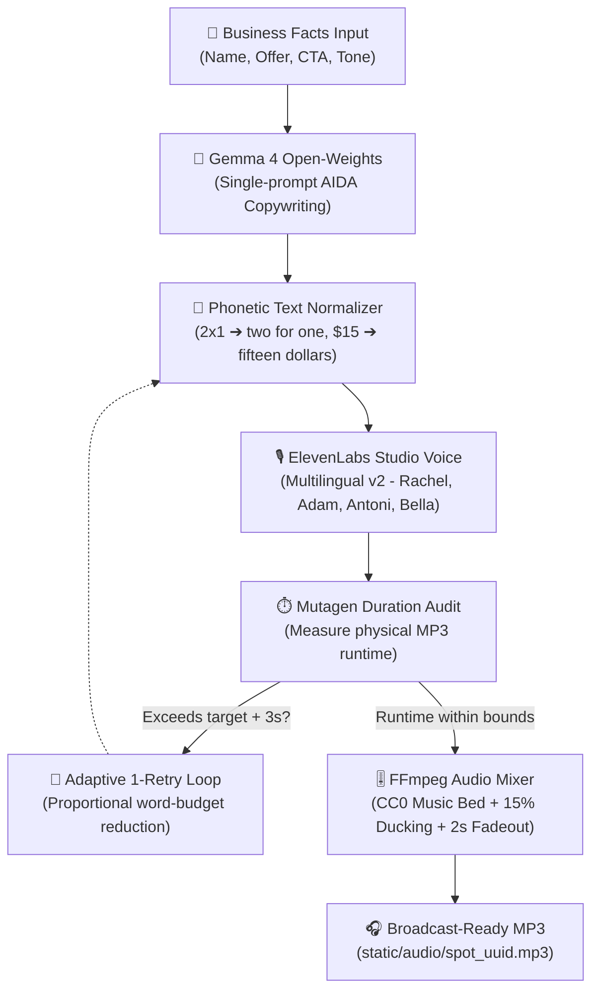

# 🎙️ SpotForge

> **AI-Powered Commercial Audio Ad Generator for Local Businesses & Freelancers.**  
> *Built with open-weight models for the [Hacktoberfest 2026 Open-Source AI Challenge: Week 2 (Side Hustle)](https://dev.to/challenges/hacktoberfest-week2-2026-10-12).*

[](https://opensource.org/licenses/MIT)
[](https://www.python.org/)
[](https://fastapi.tiangolo.com/)
[](https://ai.google.dev/gemma)
[](https://elevenlabs.io/)
[](https://ffmpeg.org/)

---

## 💡 What is SpotForge?

Neighborhood pizzerias, local barbershops, auto repair garages, and boutique clinics frequently need high-converting audio ads for **Instagram Stories, TikTok Ads, community radio, or phone hold systems**.

Yet they face a steep economic barrier:
- **Traditional Creative Agency / Recording Studio**: Charges between **\$300 and \$800 USD** for a single 30-second commercial script and professional voiceover.
- **Doing It Themselves**: Small business owners lack professional copywriting training and sound equipment, resulting in low-energy phone recordings that listeners skip.

**SpotForge** turns **3 basic facts** (business name, special offer, and call to action) into a **broadcast-ready commercial audio ad in under 15 seconds**:
1. **AIDA Ad Copywriting with Open Weights**: Google Gemma 4 generates a high-converting script following the AIDA formula (Attention ➔ Interest ➔ Desire ➔ Action) with strict audio pacing limits (~2.5 words/second in Spanish, ~2.8 words/second in English).
2. **Deterministic Phonetic Normalizer**: Automatically transforms promotional multipliers ("2x1"), currencies ("\$15"), percentages ("30%"), and telephone numbers ("555-0199") into natural spoken words with natural breathing pauses for TTS.
3. **Studio Voiceover**: ElevenLabs synthesizes studio-grade voice talent with commercial energy and natural inflection.
4. **Real MP3 Duration Calibration**: Accurately measures physical audio length with `mutagen` and executes an adaptive 1-retry rewrite loop if speech exceeds target bounds.
5. **Background Music Mixing (FFmpeg)**: Blends the voiceover with royalty-free CC0 musical beds, applying 15% automatic background ducking, infinite looping, and a smooth 2-second tail fadeout.

The result: a broadcast-quality commercial spot produced for **pennies**, allowing freelancers to resell audio assets to local clients for **\$5 to \$15 USD** with over **97% gross profit margins**.

---

## 🎧 Official Audio Demo Spots

SpotForge includes three authentic sample commercials generated end-to-end through the complete pipeline (Gemma 4 + Phonetic Normalizer + ElevenLabs + FFmpeg):

| Client Business | Category | Voice Talent | Background Music | Real Duration | Audio File |
|---|---|---|---|---|---|
| **Pizzería Don Mario** | Wood-fired artisanal Italian pizzeria | Rachel | ⚡ Upbeat Commercial (110 BPM) | **28.4s** | [`demo_pizzeria.mp3`](static/audio/demo_pizzeria.mp3) |
| **Barbería El Bigote** | Classic executive men's grooming & hot towel | Antoni | 🔥 Urban Energy (120 BPM) | **35.0s** | [`demo_barber.mp3`](static/audio/demo_barber.mp3) |
| **Apex Auto Repair** | Multi-brand automotive mechanics & brake service | Adam | ☕ Chill Acoustic (75 BPM) | **36.8s** | [`demo_autorepair.mp3`](static/audio/demo_autorepair.mp3) |

---

## 💸 Side Hustle Unit Economics & Business Model

Unlike projects that claim "$0 cost" by ignoring commercial licensing terms, SpotForge provides a **transparent, legally compliant business model**:

| Item | ElevenLabs Starter Plan ($6/mo) | Traditional Audio Agency |
|---|---|---|
| **Copywriting Engine (Gemma 4)** | **$0.00** (Google AI Studio Free Tier or local Ollama) | $150 – $300 (Human copywriter) |
| **Studio Voice Synthesis (ElevenLabs)** | **$0.08** (400 chars within 30k quota) / **$0.12** extra | $150 – $500 (Studio + Voice talent) |
| **Music Mixing & Sound Design (FFmpeg)** | **$0.00** (Local server process + CC0 Music Beds) | $50 – $100 (Audio engineer) |
| **Total Production Cost per Ad** | **$0.08 – $0.12 USD** | **$350 – $900 USD** |
| **Suggested Resale Price to Client** | **$5.00 – $15.00 USD** | $350 – $900 USD |
| **Freelancer Gross Profit Margin** | **97.6% – 99.2%** | N/A |
| **Spots Included in Base $6 Plan** | **~75 commercial ads of 30 seconds** | 0 |

> **The Freelancer Playbook**: A freelancer managing social media for 5 local shops can deliver 2 fresh promotional audio ads per week for an extra \$30/month per client. That represents **\$150/month in revenue against \$6 in operational software costs**—a sustainable, high-margin side hustle.

---

## 🌟 Why Open Innovation Matters

- **Open-Weight Intelligence for Copywriting**: Powered by **Google Gemma 4** (`gemma-4-26b-a4b-it`). Open-weight models empower developers with complete control over their infrastructure, eliminating dependence on closed black-box APIs that alter pricing or deprecate versions unexpectedly.
- **Cloud or Offline Portability**: SpotForge implements the `BaseLLMBackend` interface. It runs effortlessly via Google AI Studio in the cloud or **100% offline and locally** using Ollama (`LLM_BACKEND=ollama`), guaranteeing complete privacy for proprietary client promotions and private customer details.
- **Open Media Standards**: Audio mixing relies on **FFmpeg**, the open standard for multimedia manipulation, and CC0 public domain musical beds.

---

## 🏗️ System Architecture



---

## ⚖️ Commercial Use & Licensing

### SpotForge License
SpotForge is open-source software released under the **MIT License**.

### Language Model License (Gemma)
Google Gemma is an open-weight model family distributed under the [Gemma Terms of Use](https://ai.google.dev/gemma/terms), permitting commercial use subject to Google's acceptable use policy.

### Voice Synthesis Licensing (ElevenLabs) — IMPORTANT
- The **Free Plan** from ElevenLabs **does NOT include commercial rights** over generated audio. Free-tier audio may only be used for personal testing and requires public attribution.
- To **resell audio spots to clients**, use them in paid social media ads (Instagram, TikTok, YouTube), radio, or podcast sponsorships, you **must hold at least the Starter Plan ($6 USD/month)** with your own ElevenLabs API key.
- SpotForge utilizes a **BYOK (Bring Your Own Key)** architecture: each user inputs their own API key in `.env`. Commercial rights are cleanly backed by the user's active tier.

### Background Music Beds
All included musical beds are licensed under **Creative Commons Zero (CC0 1.0 Universal / Public Domain)**. See details in [`static/music/LICENSES.md`](static/music/LICENSES.md).

---

## 📐 Architecture Decision Records (ADRs)

Key architectural choices are formally documented through ADRs:

- [**ADR-001**: Adoption of Google Gemma 4 as Open-Weight Ad Copywriter](docs/adr/ADR-001-gemma-open-weights.md)
- [**ADR-002**: High-Fidelity Studio Voice Synthesis with ElevenLabs](docs/adr/ADR-002-elevenlabs-voiceover.md)
- [**ADR-003**: FastAPI Backend and Minimalist Vanilla SPA Frontend](docs/adr/ADR-003-fastapi-vanilla-spa.md)
- [**ADR-004**: Deterministic Phonetic Text Normalization Layer for TTS](docs/adr/ADR-004-deterministic-text-normalization.md)
- [**ADR-005**: Commercial Licensing Integrity and BYOK Architecture](docs/adr/ADR-005-licensing-and-commercial-byok.md)
- [**ADR-006**: Professional Background Musical Bed Mixing with FFmpeg](docs/adr/ADR-006-ffmpeg-audio-mixing.md)
- [**ADR-007**: Real MP3 Duration Measurement and Adaptive 1-Retry Pacing Loop](docs/adr/ADR-007-real-duration-control.md)

---

## 🚀 Quickstart & Installation

### Prerequisites
- **Python 3.10+** (tested on Python 3.12)
- **FFmpeg 6+** installed and available in system `PATH`
- Free Google AI Studio API Key ([aistudio.google.com](https://aistudio.google.com/))
- ElevenLabs API Key ([elevenlabs.io](https://elevenlabs.io/))

### 1. Clone Repository
```bash
git clone https://github.com/oscarbol09/spotforge.git
cd spotforge
```

### 2. Setup Virtual Environment
```bash
python -m venv venv
# On Windows:
venv\Scripts\activate
# On Linux / macOS:
source venv/bin/activate

pip install -r requirements.txt
```

### 3. Configure Environment Variables
```bash
cp .env.example .env
```
Edit `.env` with your credentials:
```ini
GEMINI_API_KEY=your_gemini_api_key
ELEVENLABS_API_KEY=your_elevenlabs_api_key
GEMMA_MODEL_ID=gemma-4-26b-a4b-it
ELEVENLABS_MODEL=eleven_multilingual_v2
LLM_BACKEND=gemini # or 'ollama' for offline local inference
ENABLE_MUSIC_MIXING=true
AUDIO_TTL_HOURS=24
```

### 4. Run Development Server
```bash
uvicorn main:app --reload --port 8000
```
Open [http://localhost:8000](http://localhost:8000) in your browser.

### 5. Run Automated Tests
```bash
pytest -v
```

---

## 🏆 Hacktoberfest 2026 Categories
- **Overall Winner ($250 USD)**: Full-featured project built for the *Side Hustle* prompt with transparent unit economics and high-margin freelance viability.
- **Best Use of Gemma ($200 USD)**: AIDA prompt design on Google's open-weight **Gemma 4** (`gemma-4-26b-a4b-it`), thought token extraction, and local Ollama support.
- **Best Use of ElevenLabs ($100 USD)**: Commercial voice synthesis using **ElevenLabs Multilingual v2**, dynamic voice discovery, and precise character telemetry.
- **Best Use of Render ($200 USD)**: Production-ready infrastructure blueprint in `render.yaml` with automated health checks.

---

## 📄 License
Released under the **MIT License**. See `LICENSE` for details.
