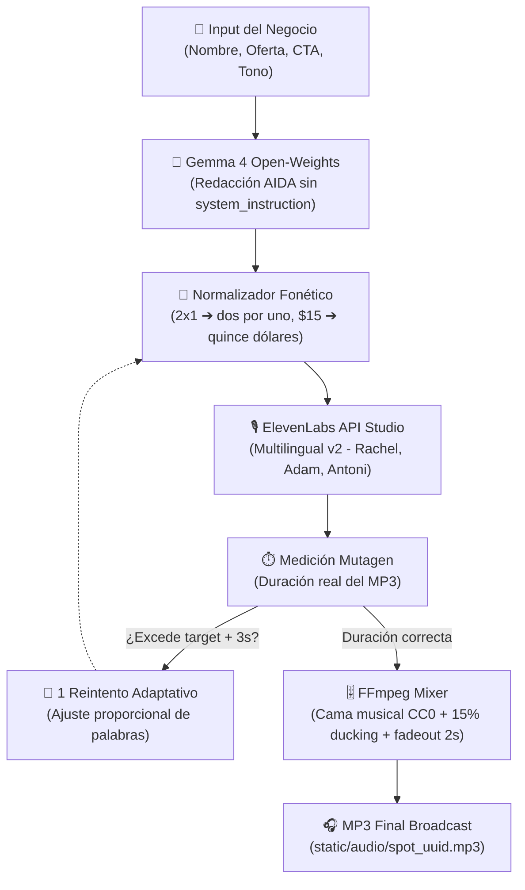

# 🎙️ SpotForge

> **Generador de cuñas publicitarias de audio con IA para negocios locales y freelancers.**  
> *Construido con modelos de pesos abiertos para el [Hacktoberfest 2026 Open-Source AI Challenge: Week 2 (Side Hustle)](https://dev.to/challenges/hacktoberfest-week2-2026-10-12).*

[](https://opensource.org/licenses/MIT)
[](https://www.python.org/)
[](https://fastapi.tiangolo.com/)
[](https://ai.google.dev/gemma)
[](https://elevenlabs.io/)
[](https://ffmpeg.org/)

---

## 💡 ¿Qué es SpotForge?

Una pizzería de barrio, barbería tradicional, taller mecánico o dentista local necesita cuñas de audio persuasivas para pautar en **Instagram Stories, TikTok Ads, radio comunitaria o el sistema de espera telefónica**.

Sin embargo, enfrentan un dilema prohibitivo:
- **Agencia de publicidad / Estudio de grabación**: cobra entre **$300 y $800 USD** por spot de 30 segundos.
- **Hacerlo ellos mismos**: no tienen copywriters comerciales ni locutores profesionales.

**SpotForge** convierte **3 datos básicos del negocio** (nombre, oferta y llamada a la acción) en una **cuña de audio lista para emisión comercial**:
1. **Redactor AIDA con IA de Pesos Abiertos**: Google Gemma 4 genera un guión persuasivo con cadencia estricta (~2.5 palabras por segundo).
2. **Normalizador Fonético Determinista**: Convierte automáticamente promociones ("2x1"), monedas ("$15"), porcentajes ("30%") y números telefónicos ("555-0199") a palabras completas con pausas de respiración naturales para TTS.
3. **Locución Profesional de Estudio**: ElevenLabs sintetiza la voz con dicción y energía comercial.
4. **Control de Duración Real**: Mide los segundos exactos del MP3 con `mutagen` y aplica un reintento adaptativo si el audio excede la cota pautada.
5. **Mezcla con Cama Musical (FFmpeg)**: Combina la voz con música de fondo CC0 con *ducking* al 15% y fundido de salida suave (*fade out* de 2 segundos).

El resultado: un spot con acabado de radio profesional producido por **centavos**, que un freelancer puede comercializar a sus clientes locales entre **$5 y $15 USD**, generando más de un **97% de margen de ganancia**.

---

## 🎧 Cuñas Oficiales de Demostración

SpotForge incluye tres ejemplos reales generados por el pipeline completo (Gemma 4 + Normalizador + ElevenLabs + FFmpeg):

| Negocio | Giro Comercial | Locutor | Cama Musical | Duración Real | Archivo de Audio |
|---|---|---|---|---|---|
| **Pizzería Don Mario** | Pizzería artesanal italiana con horno de leña | Rachel | ⚡ Upbeat Commercial (110 BPM) | **28.4s** | [`demo_pizzeria.mp3`](static/audio/demo_pizzeria.mp3) |
| **Barbería El Bigote** | Barbería clásica y estilismo masculino | Antoni | 🔥 Urban Energy (120 BPM) | **35.0s** | [`demo_barber.mp3`](static/audio/demo_barber.mp3) |
| **Apex Auto Repair** | Taller mecánico automotriz y frenos | Adam | ☕ Chill Acoustic (75 BPM) | **36.8s** | [`demo_autorepair.mp3`](static/audio/demo_autorepair.mp3) |

---

## 💸 Economía Unitaria y Modelo de Negocio ("Side Hustle")

A diferencia de afirmaciones fantasiosas de "$0 por spot", SpotForge presenta un **modelo de negocio transparente y jurídicamente viable**:

| Concepto | Plan Starter ElevenLabs ($6/mes) | Agencia Tradicional |
|---|---|---|
| **Costo del modelo de lenguaje (Gemma 4)** | **$0.00** (Google AI Studio Free Tier u Ollama local) | $150 – $300 (copywriter humano) |
| **Costo de locución (ElevenLabs)** | **$0.08** (400 chars incluidos en cuota de 30k) / **$0.12** extra | $150 – $500 (estudio + locutor) |
| **Costo de mezcla musical (FFmpeg)** | **$0.00** (proceso local en servidor con música CC0) | $50 – $100 (ingeniero de sonido) |
| **Costo total de producción por spot** | **$0.08 – $0.12 USD** | **$350 – $900 USD** |
| **Precio de venta sugerido al negocio local** | **$5.00 – $15.00 USD** | $350 – $900 USD |
| **Margen bruto del freelance** | **97.6% – 99.2%** | N/A |
| **Spots incluidos en el plan base de $6** | **~75 spots de 30 segundos** | 0 |

> Si un freelance vende solo **10 spots al mes a $10 USD** cada uno, factura **$100 USD** con un costo de producción de **$6 USD** de suscripción Starter, obteniendo **$94 USD de ganancia neta** en sus primeras semanas de side hustle.

---

## 🌟 ¿Por qué Importa la Innovación Abierta?

- **Pesos Abiertos para Redacción Persuasiva**: El motor creativo corre sobre **Google Gemma 4** (`gemma-4-26b-a4b-it`). Al ser un modelo de pesos abiertos, el desarrollador retiene el control de su infraestructura y no depende de modelos de caja negra que cambian tarifas o deprecian versiones sin previo aviso.
- **Portabilidad Cloud u Offline**: SpotForge implementa la interfaz `BaseLLMBackend`. Puede ejecutarse en la nube con Google AI Studio o **100% offline y local** mediante Ollama (`LLM_BACKEND=ollama`), garantizando privacidad absoluta para los datos promocionales de los clientes.
- **Composición de Estándares Abiertos**: La mezcla de audio se apoya en **FFmpeg**, estándar abierto de procesamiento multimedia, y pistas musicales con licencia CC0 dominio público.

---

## 🏗️ Arquitectura del Sistema



---

## ⚖️ Uso comercial y licencias

### Licencia de SpotForge
El código fuente de SpotForge está bajo licencia **MIT** (código abierto, uso libre).

### Licencia del modelo de lenguaje (Gemma)
Google Gemma es un modelo de pesos abiertos distribuido bajo los [Gemma Terms of Use](https://ai.google.dev/gemma/terms). Permite uso comercial sujeto a las condiciones de uso aceptable de Google.

### Licencia de las voces (ElevenLabs) — LEER CON ATENCIÓN
- El plan **Free** de ElevenLabs **NO incluye derechos comerciales** sobre el audio generado. Los audios generados bajo el plan gratuito solo pueden usarse para fines personales o de prueba y requieren atribución.
- Para **vender spots a clientes**, usarlos en publicidad pagada (Instagram Ads, TikTok Ads, radio, Spotify) o integrarlos en un negocio comercial, **debes contar con al menos el plan Starter ($6/mes)** de ElevenLabs con tu propia API key.
- SpotForge opera bajo el modelo **BYOK (Bring Your Own Key)**: cada usuario configura su propia API key en el archivo `.env`, por lo que los derechos comerciales del audio dependen exclusivamente del plan que el usuario tenga contratado con ElevenLabs. SpotForge no intermedia ni garantiza derechos comerciales sobre audios generados con keys de terceros.

### Licencia de las camas musicales
Las pistas musicales de fondo incluidas en SpotForge provienen de fuentes de dominio público / CC0. Ver detalle en [`static/music/LICENSES.md`](static/music/LICENSES.md).

---

## 📐 Decisiones de Arquitectura (ADRs)

El desarrollo del proyecto está documentado formalmente mediante Architecture Decision Records:

- [**ADR-001**: Adopción de Google Gemma 4 como Redactor Publicitario de Pesos Abiertos](docs/adr/ADR-001-gemma-open-weights.md)
- [**ADR-002**: Locución Comercial de Alta Fidelidad con ElevenLabs](docs/adr/ADR-002-elevenlabs-voiceover.md)
- [**ADR-003**: Arquitectura Backend FastAPI y Frontend SPA Minimalista](docs/adr/ADR-003-fastapi-vanilla-spa.md)
- [**ADR-004**: Capa Determinista de Normalización de Texto para TTS](docs/adr/ADR-004-deterministic-text-normalization.md)
- [**ADR-005**: Licenciamiento Comercial Honesto y Modelo BYOK](docs/adr/ADR-005-licensing-and-commercial-byok.md)
- [**ADR-006**: Mezcla Profesional de Cama Musical de Fondo con FFmpeg](docs/adr/ADR-006-ffmpeg-audio-mixing.md)
- [**ADR-007**: Medición de Duración Real del MP3 y Bucle Adaptativo de 1 Reintento](docs/adr/ADR-007-real-duration-control.md)

---

## 🚀 Instalación y Puesta en Marcha

### Prerrequisitos
- **Python 3.10+** (probado en Python 3.12)
- **FFmpeg 6+** instalado y en el `PATH` del sistema
- Clave de API de Google AI Studio gratuita ([aistudio.google.com](https://aistudio.google.com/))
- Clave de API de ElevenLabs ([elevenlabs.io](https://elevenlabs.io/))

### 1. Clonar el repositorio
```bash
git clone https://github.com/your-username/spotforge.git
cd spotforge
```

### 2. Instalar dependencias
```bash
python -m venv venv
# En Windows:
venv\Scripts\activate
# En Linux/macOS:
source venv/bin/activate

pip install -r requirements.txt
```

### 3. Configurar variables de entorno
```bash
cp .env.example .env
```
Edita `.env` con tus credenciales:
```ini
GEMINI_API_KEY=tu_clave_de_gemini
ELEVENLABS_API_KEY=tu_clave_de_elevenlabs
GEMMA_MODEL_ID=gemma-4-26b-a4b-it
ELEVENLABS_MODEL=eleven_multilingual_v2
LLM_BACKEND=gemini # o 'ollama' para inferencia local
ENABLE_MUSIC_MIXING=true
AUDIO_TTL_HOURS=24
```

### 4. Iniciar el servidor
```bash
uvicorn main:app --reload --port 8000
```
Visita `http://localhost:8000` en tu navegador.

### 5. Ejecutar suite de pruebas automatizadas
```bash
pytest -v
```

---

## 🏆 Categorías del Desafío Hacktoberfest 2026
- **Overall Winner ($250 USD)**: Proyecto enfocado íntegramente en la temática *Side Hustle* con economía unitaria sólida.
- **Best Use of Gemma ($200 USD)**: Redacción persuasiva AIDA con modelo Gemma 4 open-weights, filtrado de cadenas de pensamiento y soporte Ollama local.
- **Best Use of ElevenLabs ($100 USD)**: Locución comercial de alta definición con catálogo dinámico de voces y medición de consumo de caracteres.
- **Best Use of Render ($200 USD)**: Blueprint `render.yaml` listo para despliegue productivo con health checks nativos.

---

## 📄 Licencia
Distribuido bajo la Licencia **MIT**. Consulta `LICENSE` para más información.
