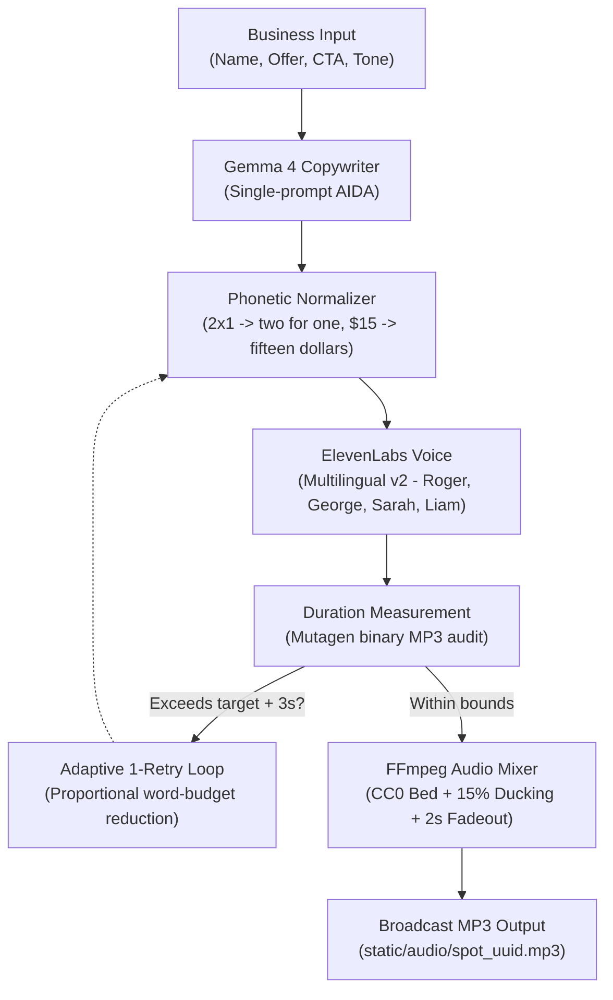

# SpotForge

Turn three basic facts about a local business into a broadcast-ready 30-second commercial audio ad using Google Gemma open weights, deterministic text normalization, ElevenLabs studio voice synthesis, and FFmpeg audio mixing.

[](https://opensource.org/licenses/MIT)
[](https://www.python.org/)
[](https://fastapi.tiangolo.com/)
[-orange.svg)](https://ai.google.dev/gemma)

---

## What is SpotForge?

Neighborhood businesses—pizzerias, barbershops, auto mechanics, dental practices—frequently need high-impact promotional audio for social video (Instagram Stories, TikTok Ads), local radio, or telephone hold messaging.

Most cannot afford traditional production:
- **Creative Agencies and Studios**: Cost \$300 to \$800 per 30-second spot for scriptwriting, studio recording, and voice talent.
- **Manual Recording**: Cellphone microphone recordings lack commercial energy, proper breathing pauses, and background music, leading listeners to scroll away.

**SpotForge** converts **3 business inputs** (business name, core offer, and call to action) into an air-ready commercial ad in seconds:

1. **AIDA Ad Copywriting**: Google Gemma 4 generates a structured script (Attention -> Interest -> Desire -> Action) constrained by speech cadence targets (~2.5 words/second in Spanish, ~2.8 words/second in English).
2. **Phonetic Normalization**: A deterministic rule engine converts promotions (`2x1`), currencies (`$15`), percentages (`30%`), and phone numbers (`555-0199`) into natural spoken words with breathing pauses.
3. **Studio Voice Synthesis**: ElevenLabs renders the normalized text with commercial inflection and crisp diction.
4. **Physical Duration Audit**: Measures actual runtime from the MP3 header with `mutagen`. If the take exceeds target length by over 3 seconds, it triggers a single adaptive retry with a proportionally reduced word budget.
5. **Background Music Mixing**: FFmpeg loops and blends a royalty-free CC0 musical bed with 15% volume ducking under the voice and a 2-second tail fadeout.

---

## Audio Demo Spots

Three sample spots produced end-to-end with the pipeline (Gemma 4 + Phonetic Normalizer + ElevenLabs + FFmpeg):

| Business | Category | Voice Talent | Music Bed | Real Duration | Audio File |
|---|---|---|---|---|---|
| **Pizzería Don Mario** | Wood-fired artisanal Italian pizzeria | George | Upbeat Commercial (110 BPM) | **28.4s** | [`demo_pizzeria.mp3`](static/audio/demo_pizzeria.mp3) |
| **Barbería El Bigote** | Executive men's grooming & hot towel | Liam | Urban Energy (120 BPM) | **31.9s** | [`demo_barber.mp3`](static/audio/demo_barber.mp3) |
| **Apex Auto Repair** | Multi-brand automotive mechanics & brakes | Roger | Chill Acoustic (75 BPM) | **27.3s** | [`demo_autorepair.mp3`](static/audio/demo_autorepair.mp3) |

---

## Economics and Business Model

Many AI projects claim "$0 cost" by glossing over third-party licensing. Commercial resale of synthesized voiceover requires clear licensing:

| Parameter | ElevenLabs Starter Plan ($6/mo) | Traditional Audio Agency |
|---|---|---|
| **Copywriting (Gemma 4)** | **$0.00** (Google AI Studio Free Tier or local Ollama) | $150 – $300 (Copywriter) |
| **Voiceover (ElevenLabs)** | **$0.08** (within 30k char quota) / **$0.12** extra | $150 – $500 (Studio + Talent) |
| **Mixing & Music (FFmpeg)** | **$0.00** (Server-side process + CC0 Music Beds) | $50 – $100 (Sound engineer) |
| **Total Production Cost** | **$0.08 – $0.12 USD** | **$350 – $900 USD** |
| **Suggested Resale Price** | **$5.00 – $15.00 USD** | $350 – $900 USD |
| **Gross Profit Margin** | **97.6% – 99.2%** | N/A |
| **Ads Included in $6/mo** | **~75 commercial ads of 30 seconds** | 0 |

**Freelance Economics**: Managing social media for 5 local clients with 2 fresh promo spots per week produces \$150/month in revenue against \$6 in software costs—a defensible, high-margin side hustle.

---

## Why Open Innovation Matters

- **Open Weights for Core Copywriting**: Built on **Google Gemma 4** (`gemma-4-26b-a4b-it`). Open-weight models protect developers from closed API price spikes and deprecations.
- **Offline and Cloud Portability**: Implements `BaseLLMBackend`. The system runs via Google AI Studio in the cloud or 100% offline using local Ollama (`LLM_BACKEND=ollama`), keeping unreleased client promotions and private numbers on-premises.
- **Open Standards**: Relies on FFmpeg for audio processing and public domain CC0 music beds.

---

## System Architecture



---

## Commercial Use and Licensing

### SpotForge License
SpotForge is open-source software licensed under the **MIT License**.

### Language Model License (Gemma)
Google Gemma is an open-weight model family distributed under the [Gemma Terms of Use](https://ai.google.dev/gemma/terms), permitting commercial use subject to Google's acceptable use policy.

### Voice Synthesis Licensing (ElevenLabs)
- The **Free Plan** from ElevenLabs **does not include commercial rights** over generated audio. Free-tier audio may only be used for personal testing and requires public attribution.
- To **resell audio spots to clients** or run them in paid advertising (Instagram, TikTok, YouTube, radio, podcasts), users **must hold at least the Starter Plan ($6 USD/month)** with their own API key.
- SpotForge uses a **Bring Your Own Key (BYOK)** model: each user configures their own key in `.env`. Commercial rights remain directly anchored to the user's active ElevenLabs tier.

### Music Beds
All bundled background tracks are licensed under **Creative Commons Zero (CC0 1.0 Universal / Public Domain)**. Full attributions and source metadata are tracked in [`static/music/LICENSES.md`](static/music/LICENSES.md).

---

## Known Limitations and Technical Constraints

1. **Network Dependency for Voiceover**: Speech synthesis requires outbound HTTPS connectivity to ElevenLabs. While the copywriting engine can run 100% offline via Ollama, audio synthesis depends on API connectivity.
2. **Cadence Variance Across Voice Profiles**: Voice talents read at slightly different rates. SpotForge mitigates this through target word budgeting and an adaptive 1-retry loop, but edge cases may still require manual script tweaks in the UI.
3. **FFmpeg Binary Requirement**: Background music mixing requires `ffmpeg` in system `PATH`. If unavailable, SpotForge gracefully degrades to clean voiceover with an explicit, non-blocking warning.
4. **Cloud LLM Rate Limits**: Free-tier Google AI Studio accounts have standard RPM limits. High-concurrency production deployments should point `LLM_BACKEND=ollama` to a local or self-hosted GPU instance.

---

## Architecture Decision Records

Architectural decisions are formally recorded in `docs/adr/`:

- [**ADR-001**: Adoption of Google Gemma 4 as Open-Weight Ad Copywriter](docs/adr/ADR-001-gemma-open-weights.md)
- [**ADR-002**: High-Fidelity Studio Voice Synthesis with ElevenLabs](docs/adr/ADR-002-elevenlabs-voiceover.md)
- [**ADR-003**: FastAPI Backend and Minimalist Vanilla SPA Frontend](docs/adr/ADR-003-fastapi-vanilla-spa.md)
- [**ADR-004**: Deterministic Phonetic Text Normalization Layer for TTS](docs/adr/ADR-004-deterministic-text-normalization.md)
- [**ADR-005**: Commercial Licensing Integrity and BYOK Architecture](docs/adr/ADR-005-licensing-and-commercial-byok.md)
- [**ADR-006**: Professional Background Musical Bed Mixing with FFmpeg](docs/adr/ADR-006-ffmpeg-audio-mixing.md)
- [**ADR-007**: Real MP3 Duration Measurement and Adaptive 1-Retry Pacing Loop](docs/adr/ADR-007-real-duration-control.md)

---

## Quickstart

### Prerequisites
- Python 3.10+
- FFmpeg 6+ in system `PATH`
- Google AI Studio API Key ([aistudio.google.com](https://aistudio.google.com/))
- ElevenLabs API Key ([elevenlabs.io](https://elevenlabs.io/))

### 1. Clone Repository
```bash
git clone https://github.com/oscarbol09/spotforge.git
cd spotforge
```

### 2. Setup Environment
```bash
python -m venv venv
# On Windows:
venv\Scripts\activate
# On Linux / macOS:
source venv/bin/activate

pip install -r requirements.txt
```

### 3. Configure Environment Variables
```bash
cp .env.example .env
```
Edit `.env`:
```ini
GEMINI_API_KEY=your_gemini_api_key
ELEVENLABS_API_KEY=your_elevenlabs_api_key
GEMMA_MODEL_ID=gemma-4-26b-a4b-it
ELEVENLABS_MODEL=eleven_multilingual_v2
LLM_BACKEND=gemini # or 'ollama' for offline local inference
ENABLE_MUSIC_MIXING=true
AUDIO_TTL_HOURS=24
```

### 4. Run with Docker (Recommended for Containerized FFmpeg)
```bash
docker build -t spotforge .
docker run -p 8000:8000 --env-file .env spotforge
```

### 5. Run Development Server Directly
```bash
uvicorn main:app --reload --port 8000
```
Open [http://localhost:8000](http://localhost:8000) in your browser.

### 6. Run Automated Tests
```bash
pytest -v
```
All 30 tests covering copy generation, duration control, text normalization, voice synthesis, rate limiting, and asset serving should pass.

---

## Hacktoberfest 2026 Categories
- **Overall Winner ($250 USD)**: Full-featured project built for the Side Hustle prompt with transparent unit economics and freelance viability.
- **Best Use of Gemma ($200 USD)**: AIDA prompt design on Google's open-weight **Gemma 4** (`gemma-4-26b-a4b-it`), thought token filtering, and local Ollama support.
- **Best Use of ElevenLabs ($100 USD)**: Commercial voice synthesis using **ElevenLabs Multilingual v2**, dynamic voice discovery, and exact character telemetry.
- **Best Use of Render ($200 USD)**: Turnkey deployment blueprint in `render.yaml` with automated health checks.

---

## License
Released under the **MIT License**. See `LICENSE` for details.
